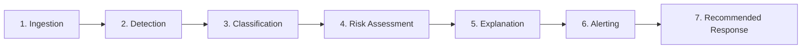

# CYBERGUARD — AI-Powered Cyber Threat Detection & Response Platform

[](https://python.org)
[](https://fastapi.tiangolo.com)
[](https://react.dev)
[](https://vitejs.dev)
[](https://docs.pydantic.dev/)
[](https://pytest.org)

**CYBERGUARD** is an institutional-grade, multi-layered cyber-defense and digital-trust platform. It bridges human-targeted psychological attacks (phishing, social engineering, executive impersonation, synthetic deepfakes) with system-level technical attacks (impossible travel velocity, brute-force spraying, credential theft, session deviations).

---

## ⚡ The Canonical 7-Stage Pipeline

All threat data flows sequentially through the 7-stage processing lifecycle:



1. **Ingestion & Normalization:** Ingests emails, URLs, media, and security logs into the standard **Unified Event Model (UEM)** envelope.
2. **Detection:** Domain-specific ML models and rules extract features and compute primary threat probabilities.
3. **Classification:** Threat category and attack sub-type are identified (e.g., `Credential Phishing`, `Executive Fraud`, `Impossible Travel`).
4. **Risk Assessment:** Synthesizes raw model confidences with security heuristics into a unified $0 - 100$ score and 5-tier risk band.
5. **Explanation:** Generates evidence vectors and plain-language reasoning explaining *why* the event is malicious.
6. **Alerting & Incident Creation:** Persists the event and creates actionable incident tickets in the SOC queue if risk thresholds are exceeded.
7. **Recommended Response:** Formulates prioritized mitigation recommendations and triggers simulated containment actions.

---

## 🌟 Core System Highlights

### 1. The Three Mandatory Threat Scenarios

- **Scenario 1: Phishing & Malicious URL Detector**
  - **Text NLP Engine:** Detects urgency triggers, credential harvesting prompts, fear appeals, and authority exploitation.
  - **URL & Domain Heuristics:** Levenshtein edit distance against high-value target brands (`paypal.com`, `microsoft.com`, `apple.com`), domain Shannon entropy calculation, raw IP host identification, and suspicious TLD filtering.

- **Scenario 2: Digital Impersonation & Deepfake Detector**
  - **Identity Discrepancy Verification:** Checks display-name masquerading (e.g. VIP executive titles) originating from free public webmail domains (`gmail.com`, `yahoo.com`).
  - **Business Email Compromise (BEC):** Detects confidential wire transfer pretexts and display-name header spoofing.
  - **Synthetic Media Heuristics:** Flags multimedia frequency anomalies and computes authenticity confidence scores.

- **Scenario 3: Credential Theft & Behavioral ATO Engine**
  - **Impossible Travel Velocity:** Computes great-circle Haversine distance divided by elapsed time ($V = \frac{\text{Distance}}{\Delta t}$). Flags velocities $> 900\text{ km/h}$ as Critical anomalies.
  - **Brute-Force Counter:** Tracks sliding-window consecutive failed authentication attempts ($\ge 5$ failures).
  - **Novel Device Profiling:** Identifies unfamiliar device user-agent signatures.

---

### 2. Calibrated Hybrid Risk Scoring Engine

CYBERGUARD avoids black-box opacity by grounding scores with deterministic security indicators:

$$\text{Risk Score} = \min\left(100, \; (C_{\text{model}} \times 60) + (I_{\text{norm}} \times 40)\right)$$

| Score Range | Risk Level | Description | Automated Action |
|---|---|---|---|
| **0 – 19** | `Safe` | Normal, benign traffic. No malicious indicators found. | Log event; allow uninterrupted. |
| **20 – 39** | `Low` | Minor heuristic anomalies; low probability of maliciousness. | Log informational record; silent telemetry. |
| **40 – 59** | `Medium` | Ambiguous indicators; potential suspicious context. | Display visual warning banner to user. |
| **60 – 79** | `High` | Strong evidence of malicious intent; multiple severe indicators. | Auto-create SOC Incident; quarantine artifact. |
| **80 – 100** | `Critical` | Confirmed active attack; high confidence & critical indicators. | Immediate SOC alert; auto-simulate containment; revoke tokens. |

---

### 3. Explainable AI (XAI) — Rule 1.3: Zero "Naked" Alerts

Under CYBERGUARD engineering governance, no alert may simply state *"Threat Detected"*. Every verdict ($Score \ge 20$) includes:
1. **Executive Summary:** Plain-language high-impact assessment.
2. **Quantified Evidence Points:** Concrete parameters (e.g., Levenshtein distance, Shannon entropy score, travel velocity in km/h).
3. **Contextual Reasoning:** Cohesive narrative explaining how features compound into the verdict.

---

### 4. Safe Simulation Sandbox — Rule 1.4

Automated containment actions (e.g., domain blacklisting, token revocation, host quarantine) execute in **Simulated Mode** during prototypes and evaluation. Every action produces a structured entry in the audit stream showing what production API call (Okta, Cloudflare, Microsoft Graph) would be dispatched in live deployment.

---

## 📂 Repository Layout

```
CYBERGUARD/
├── backend/
│   ├── app/
│   │   ├── api/             # FastAPI REST endpoints
│   │   ├── auth/            # JWT authentication & password hashing
│   │   ├── db/              # Supabase Cloud client (PostgreSQL)
│   │   ├── detectors/       # Phishing, Impersonation & Anomaly detectors
│   │   ├── explain/         # Explainable AI (XAI) engine
│   │   ├── response/        # Containment & mitigation engine
│   │   ├── risk/            # Calibrated hybrid risk scoring engine
│   │   ├── schemas/         # Unified Event Model (UEM) Pydantic schemas
│   │   ├── config.py        # Settings & environment configuration
│   │   └── main.py          # FastAPI application entrypoint
│   ├── datasets/            # Curated demo scenarios (JSON)
│   ├── tests/               # Automated unit & integration tests
│   ├── README.md            # Backend-specific architecture & API documentation
│   └── requirements.txt     # Python dependencies
├── docs/                    # PRD, Architecture, Rules, Design, Roadmap & Extensions
├── frontend/                # React + Vite SOC Command Center
│   ├── src/
│   │   ├── components/      # Modular visual components
│   │   │   ├── common/      # KpiCard, RiskGauge, LoadingFallback
│   │   │   ├── incident/    # IncidentDetailModal
│   │   │   ├── navigation/  # Header, Sidebar
│   │   │   ├── threat/      # ExplainabilityCard (XAI)
│   │   │   └── timeline/    # AttackTimeline
│   │   ├── constants/       # Severity colors, risk tiers & MITRE mappings
│   │   ├── context/         # Centralized Auth & SOC Telemetry React Contexts
│   │   ├── layouts/         # Protected MainLayout shell
│   │   ├── pages/           # Domain-isolated page views
│   │   │   ├── auth/        # Login, Signup
│   │   │   ├── dashboard/   # Executive Command Center
│   │   │   ├── incidents/   # Incident Triage & Resolution
│   │   │   ├── intel/       # MITRE ATT&CK Matrix
│   │   │   ├── models/      # AI Model Telemetry & Benchmarks
│   │   │   └── studio/      # Interactive Threat Simulator
│   │   ├── routes/          # Modular routing layer (React Router v7)
│   │   │   ├── guards/      # ProtectedRoute auth guard
│   │   │   ├── modules/     # Feature route definitions (auth, dashboard, etc.)
│   │   │   └── AppRoutes.jsx# Dynamic route composition tree
│   │   ├── services/        # Asynchronous API client service
│   │   ├── App.jsx          # Top-level provider tree
│   │   ├── index.css        # Dark SOC cyber aesthetic tokens
│   │   └── main.jsx         # DOM entrypoint
│   ├── README.md            # Frontend-specific architecture & UI documentation
│   ├── package.json
│   └── vite.config.js       # Reverse proxy configuration
├── run_backend.py           # Convenience root launcher for backend
├── pytest.ini               # Pytest configuration
├── .env.example             # Environment configuration template
└── .gitignore
```

---

## 🚀 Quickstart Guide

### Prerequisites
- **Python 3.11+**
- **Node.js 18+ & npm**

### Terminal 1: Launch Backend Server

#### Option A: Run directly without activating `.venv` (Fastest)
From the project root:
```powershell
.\.venv\Scripts\python.exe backend\run_backend.py
```
Or if you navigated into `backend/`:
```powershell
cd backend
..\.venv\Scripts\python.exe run_backend.py
```

#### Option B: Activate `.venv` first
```powershell
# 1. Activate the Python virtual environment (from project root)
.\.venv\Scripts\Activate.ps1   # Windows PowerShell
# source .venv/bin/activate    # Linux / macOS

# 2. Start the FastAPI backend
python backend/run_backend.py
```

- **Backend API:** `http://127.0.0.1:8000`
- **Interactive Swagger Docs:** `http://127.0.0.1:8000/docs`

### Terminal 2: Launch Frontend Dashboard
```powershell
# 1. Navigate to the frontend directory
cd frontend

# 2. Start Vite development server
npm run dev
```
- **Command Center Dashboard:** `http://localhost:5173`

---

## 🧪 Automated Testing & Verification

Run the full pytest suite from the root directory without activating `.venv`:
```powershell
.\.venv\Scripts\pytest -v
```
Or if `.venv` is activated:
```powershell
pytest -v
```

All 8 tests validate:
- ✅ **UEM Compliance:** Pydantic schema validation for events, indicators, and actions.
- ✅ **Risk Engine:** Boundary clamping $[0, 100]$ and severity tier mapping.
- ✅ **Domain Heuristics:** Levenshtein edit distance and Shannon entropy metrics.
- ✅ **Scenario 1 Detector:** Lookalike brand domain and urgency keyword detection.
- ✅ **Scenario 2 Detector:** VIP executive display-name and public webmail discrepancy.
- ✅ **Scenario 3 Detector:** Impossible travel velocity calculation ($>900\text{ km/h}$).
- ✅ **Explainability Engine:** Zero naked alerts invariant (Summary + Evidence + Reasoning).
- ✅ **Orchestrator Pipeline:** Full 7-stage end-to-end execution.

---

